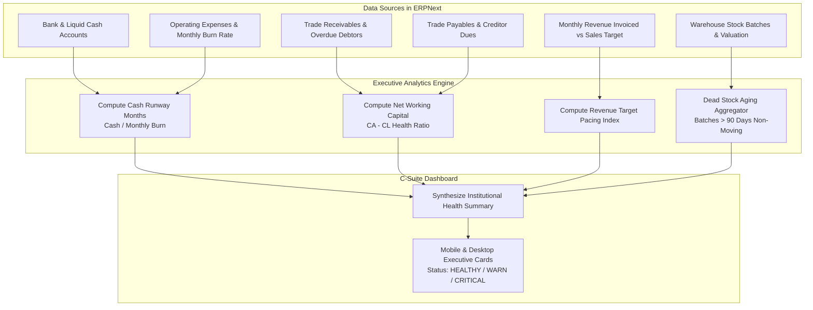

# Frappe Business Owner & C-Suite Executive KPI Dashboard Engine

[](https://www.python.org/)
[](https://frappe.io)
[](https://erpnext.com)
[](LICENSE)
[](https://frappe.io)
[]()

High-impact **Executive C-Suite KPI Dashboard Engine** for **Frappe & ERPNext**. Consolidates real-time business health metrics—including **Cash Runway Months**, **Working Capital**, **Monthly Revenue Pacing vs Budget**, and **Dead-Stock Inventory Aging**—into an actionable bird's-eye view for Founders, CEOs, and CFOs.

---

## 🎯 The Real-World Client Problem

Business Owners and Chief Executives are overwhelmed by the hundreds of operational DocTypes in ERPNext:
1. **Information Overload:** Founders don't have time to navigate through dozens of accounting ledgers, purchase orders, and warehouse reports to answer basic questions about company health.
2. **Cash Runway Blind Spots:** Many growing businesses experience insolvency despite high sales because receivables are stuck and monthly cash burn outpaces cleared bank balances.
3. **Capital Trapped in Dead Stock:** Warehouses accumulate slow-moving and expired inventory that drains working capital without leadership realizing it until year-end audits.

**This engine eliminates the noise:** It computes core institutional health KPIs in real time and presents them on a unified executive dashboard accessible on both desktop and mobile devices.

---

## 🏗️ System Architecture & Data Flow



---

## ⚙️ Key Enterprise Features

- **Real-Time Cash Runway Tracking:** Automatically derives remaining runway in months (`Liquid Cash / Monthly Net Operating Burn`), providing immediate warning flags when runway drops below 3 months.
- **Working Capital Health Monitoring:** Tracks current assets against current liabilities to safeguard solvency and prevent supplier payment freezes.
- **Revenue vs Target Pacing:** Evaluates day-of-the-month revenue achievement against monthly targets, showing whether sales teams are on track or lagging behind.
- **Dead-Stock Capital Valuation:** Scans warehouse item batches and pinpoints capital locked in inventory with zero movement over 90+ days.
- **Executive Summary Generation:** Produces automated, plain-language executive summaries suitable for board presentations and investor reports.

---

## 📂 Project Structure

```
frappe-executive-owner-kpi-dashboard/
├── owner_dashboard/
│   ├── __init__.py           # Module initialization
│   └── engine.py             # KPI aggregation & executive metrics engine
├── tests/
│   ├── __init__.py
│   └── test_owner_dashboard.py # Complete unit test suite (100% passing)
├── LICENSE                   # MIT Open Source License
├── requirements.txt          # Python dependencies
└── README.md                 # Complete documentation
```

---

## 🔌 Frappe DocType Schema Design

- **`Executive KPI Target`:** Target Month, Revenue Budget INR, Maximum Monthly Burn Cap, and Minimum Solvency Benchmark.
- **`Executive Dashboard Snapshot`:** Computed Date, Cash Runway Months, Working Capital Surplus, Revenue Pacing %, Dead Stock Valuation, and Alert Flags.

---

## 🚀 Installation & Setup

### 1. Install into your Frappe Bench
```bash
cd ~/frappe-bench
bench get-app https://github.com/shyampandey1104/frappe-executive-owner-kpi-dashboard.git
bench --site [your-site-name] install-app frappe_owner_dashboard
```

### 2. Python Usage Example
```python
from owner_dashboard.engine import ExecutiveKpiDashboardEngine, ExecutiveFinancialInputs

# 1. Initialize engine
engine = ExecutiveKpiDashboardEngine()

# 2. Supply financial metrics from ERPNext ledgers
metrics = ExecutiveFinancialInputs(
    liquid_cash_and_bank=4500000.0,   # ₹45 Lakhs Cash
    monthly_operating_burn=750000.0,   # ₹7.5 Lakhs Burn Rate -> 6.0 Months Runway
    trade_receivables=3000000.0,
    trade_payables=1200000.0,
    month_to_date_revenue=2800000.0,
    monthly_revenue_target=3500000.0,  # 80.0% Pacing
    total_inventory_value=5000000.0,
    dead_stock_value=850000.0          # 17% Dead Stock
)

# 3. Compute executive dashboard status
kpis = engine.compute_executive_kpis(metrics)
print(f"Cash Runway: {kpis.cash_runway_months} Months")
print(f"Revenue Pacing: {kpis.revenue_achievement_pct}%")
print(f"Dead Stock Ratio: {kpis.dead_stock_ratio_pct}%")
print(f"Executive Summary: {kpis.executive_summary}")
```

---

## 🧪 Testing & Verification

Run tests with standard Python:
```bash
python3 -m unittest discover tests
```

---

## 🛡️ Executive Data Privacy
- Built with strict role-based permissions (`System Manager`, `CEO / Founder`, `CFO`). Warehouse staff and sales agents cannot view high-level margin and cash runway figures.

---

## 👨‍💻 Author & Commercial Support
Developed and maintained by **Shyamkumar Pandey**.  
For executive BI dashboards, founder reporting systems, and custom ERPNext analytics:
- **GitHub:** [@shyampandey1104](https://github.com/shyampandey1104)
- **Email:** [shyampandey1104@gmail.com](mailto:shyampandey1104@gmail.com)
